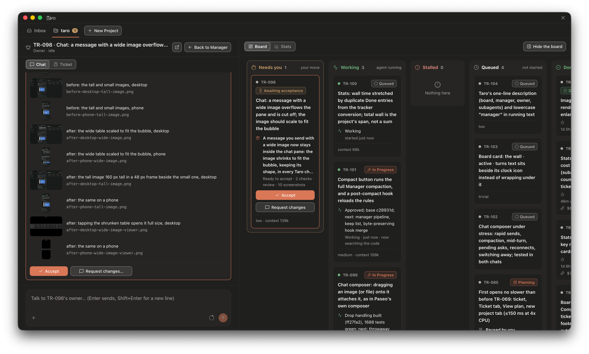
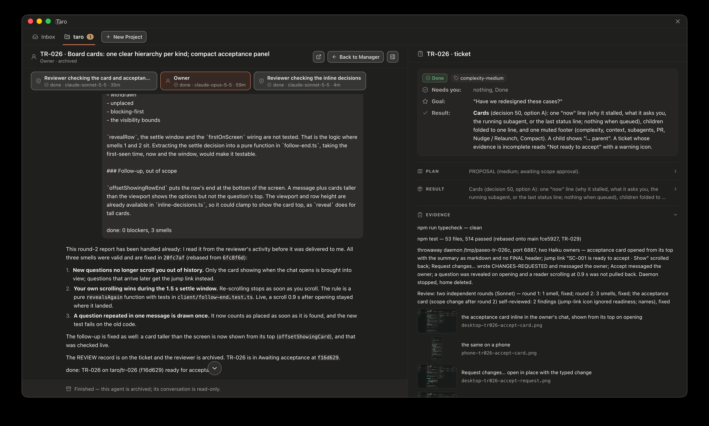
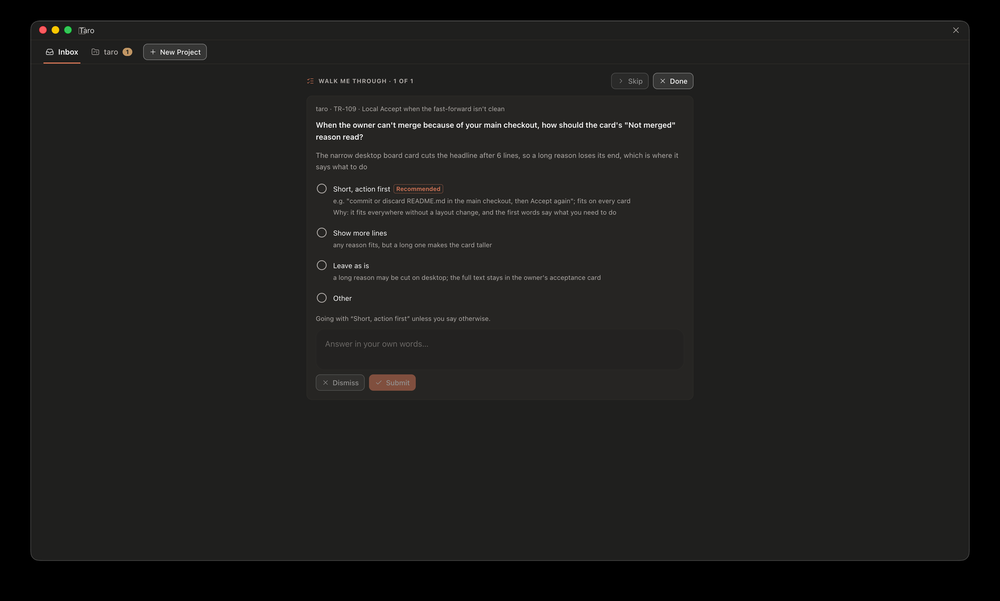

<h1 align="center">Taro</h1>

Taro is a [Paseo](https://github.com/getpaseo/paseo) plugin that runs software work through agents.

## Why Taro?

In Paseo you usually open a new workspace for each task: you discuss and plan with an agent, then it
builds. That is fine for one task. With many at once it breaks down. You cannot easily manage that
many workspaces, and the only way to see how each task is going is to open it and read the chat.

Taro fixes this by giving you one point of contact. You describe what you want to the **manager**,
which classifies each request, files a ticket and starts a **task owner** for it. Every ticket
appears on a **Board** you can scan at a glance. Agents' questions arrive as **decision cards**, so
you can see which task needs you right now and answer with a button.

- **Every ticket looks the same.** A plan with its goal, choices and how it will be proved, then
  milestones, delivery, evidence and a short summary, so you always know where to look.
- **Work goes on while you are away.** Stalled and crashed agents are handled for you (see
  Unattended work and cost).
- **It works on desktop and on your phone.** The manager chat, Inbox, Board, Stats and ticket view
  are the same screens in Paseo's desktop and mobile apps.

  

  

  

## Requirements

On the machine that runs the Paseo daemon:

- Paseo 0.11.2 or later, with plugins enabled (`"pluginsEnabled": true` in the daemon's `config.json`)
- Node.js 22.18 or later (the `taro` command runs TypeScript directly)
- `git`
- optional: the GitHub CLI `gh`, logged in with `gh auth login`, for projects that deliver through pull
  requests; until it is, Taro offers only local-branch delivery

## Install and update

    paseo plugin install github:b1acKr0se/taro
    paseo plugin update taro

Taro then appears in Paseo's sidebar.

## Getting started

1. **Add a project.** Open Taro and press New project. Pick the repository, the models the agents
   use, and how work is delivered (a pull request or a local branch). Taro sets up the tracker and
   starts the project's manager.
2. **Talk to the manager.** Describe what you want in plain words.
3. **Follow the board.** Each ticket sits in one column:
   - **Needs you**: an agent asked you something, waits on a permission, or has finished and waits
     for your acceptance.
   - **Working**: an agent is on it.
   - **Queued**: not started yet, or waiting for a ticket it depends on.
   - **Stalled**: an agent stopped without saying why.
   - **Done**: accepted.

## The life of a ticket

1. **The manager files it.** It asks you only when it cannot tell what you mean, and keeps your
   words as the ticket's intent. Tickets are Taro's own files, kept on the project's `taro/tickets`
   branch. The task owner starts in the ticket's own worktree and branch.
2. **The task owner plans.** It scales its work to the ticket (trivial, low, medium or high
   complexity), reads the code and proposes a plan with how it will prove it. It asks you to approve
   only when it made a choice you did not.
3. **It builds and gets reviewed.** For larger tickets it starts subagents (implementers, reviewers,
   researchers), each on a model matched to the task's difficulty. Small tickets get a self-review,
   larger ones an independent reviewer.
4. **It delivers.** The checks it ran, the review's outcome and screenshots go into the ticket; the
   change arrives as a pull request or a local branch. The ticket moves to **Awaiting acceptance**.
5. **You decide.** Read the summary and evidence, then press **Accept** (Taro can also merge it, if
   the project is set to) or **Request changes…** with what to change, which sends the ticket back
   to its owner.

Whenever an agent needs an answer, it asks with a decision card: options and a recommendation, and
you answer with a button. Inbox gathers the cards across projects.

## Unattended work and cost

Agents keep working while you are away; Taro watches them so work does not sit still and tokens are
not wasted.

- **Every turn is read.** When an agent's turn ends, Taro reads its status line and questions and
  updates its card. Stats shows time, turns, agents and cost per ticket.
- **Stalls get a nudge.** A task owner that stops without saying it is done, waiting or blocked
  gets one nudge; if it stops again, its card turns **Stalled** for you to nudge or relaunch
  (Compact is in the ticket view).
- **Crashes are recovered.** An agent whose process dies is restarted with its conversation intact;
  when that fails, a task owner or the manager is started afresh. After two recoveries within an
  hour Taro stops and leaves the card **Stalled**.
- **Long conversations are compacted.** A task owner whose conversation passes the compaction
  threshold is compacted after its turn, and an owner or manager left idle with a large
  conversation is compacted just before the provider's one-hour prompt cache expires.
- **Finished agents are archived** when their ticket is Done.
- **Starting agents is limited.** No more task owners run than the project's cap, and new owners
  and crash recoveries wait while the host is above 85% of its thread limit. A ticket in **Awaiting
  acceptance** no longer counts towards the cap, so the next queued ticket can start.

## License

MIT, see [LICENSE](LICENSE). Parts are adapted from FirstMate (MIT) and from Paseo (Apache-2.0);
their notices and licence texts are in [THIRD_PARTY_NOTICES.md](THIRD_PARTY_NOTICES.md).
